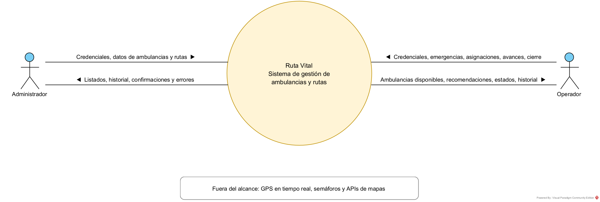
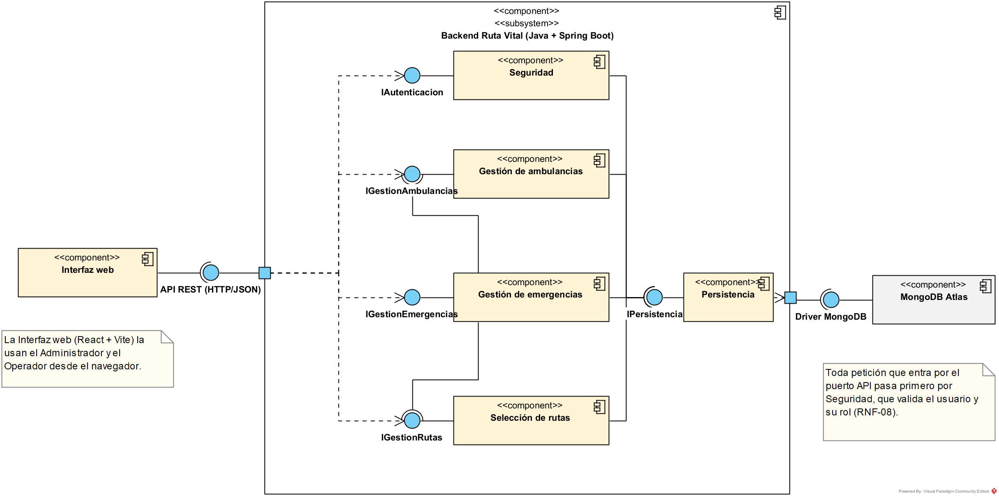
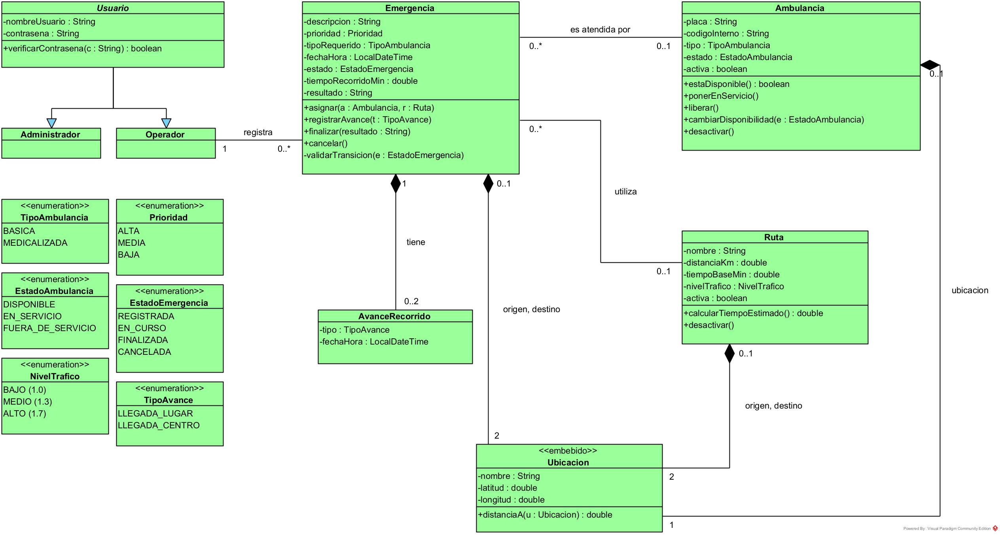
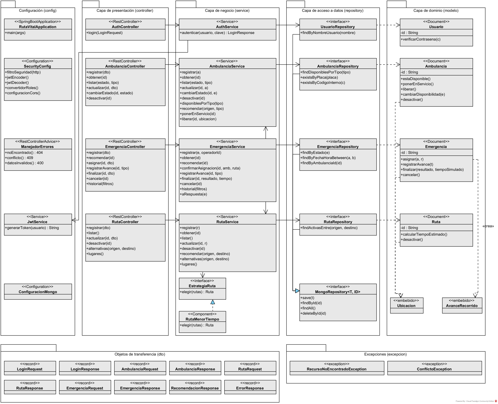
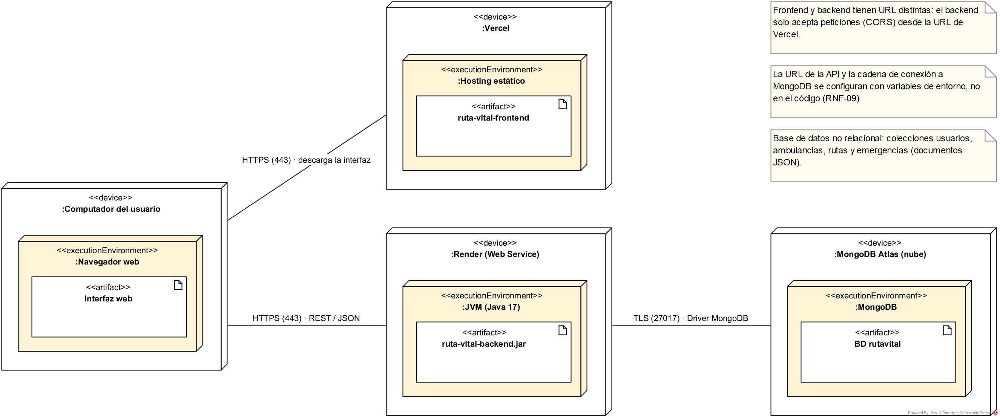

# Ruta Vital — Backend

## Diagramas

### 1. Vista de contexto



### 2. Vista funcional



### 3. Vista lógica



### 4. Vista de desarrollo



### 5. Vista de despliegue



## Descripción

API REST para gestionar ambulancias, rutas y emergencias en San Juan de Pasto. Hecha con Java 17, Spring Boot 3.5, Spring Data MongoDB y Spring Security con JWT.

## Arquitectura

Arquitectura por capas, según la vista de desarrollo:

| Paquete | Responsabilidad |
|---|---|
| `config` | Arranque, seguridad (JWT y CORS), configuración de MongoDB y manejo global de errores |
| `controller` | Endpoints REST (`/api/...`) |
| `service` | Reglas de negocio; `EstrategiaRuta` / `RutaMenorTiempo` (patrón Strategy) |
| `repository` | Acceso a MongoDB con Spring Data |
| `modelo` | Documentos y lógica de dominio (Experto en información) |
| `dto` | Datos de entrada y salida con validaciones |
| `excepcion` | `RecursoNoEncontradoException` (404) y `ConflictoException` (409) |

## Variables de entorno

| Variable | Uso | Valor local por defecto |
|---|---|---|
| `MONGODB_URI` | Cadena de conexión (MongoDB Atlas en producción) | `mongodb://localhost:27017/rutavital` |
| `JWT_SECRET` | Clave para firmar los tokens (mínimo 32 caracteres) | clave de desarrollo |
| `JWT_EXPIRACION_HORAS` | Vigencia del token | `8` |
| `FRONTEND_URL` | Origen permitido por CORS (URL de Vercel) | `http://localhost:5173` |
| `PORT` | Puerto HTTP (Render lo asigna) | `8080` |

## Ejecutar

```bash
mvn test              # pruebas
mvn spring-boot:run   # arrancar en local
```

En Windows, `probar-backend.bat` descarga Maven si no está instalado, corre las pruebas y deja el resultado en `resultado-pruebas.log`.

## Endpoints

Todos, excepto el login, requieren `Authorization: Bearer <token>`.

| Método | Ruta | Rol |
|---|---|---|
| POST | `/api/auth/login` | público |
| POST, PUT `/{id}`, PATCH `/{id}/estado`, PATCH `/{id}/desactivar` | `/api/ambulancias` | ADMINISTRADOR |
| GET, GET `/{id}` | `/api/ambulancias` | ambos |
| POST, GET, PUT `/{id}`, PATCH `/{id}/desactivar` | `/api/rutas` | ADMINISTRADOR |
| GET `/alternativas?origen&destino`, GET `/lugares` | `/api/rutas` | ambos |
| POST, GET `/{id}/recomendacion`, PATCH `/{id}/asignacion`, POST `/{id}/avances`, PATCH `/{id}/finalizacion`, PATCH `/{id}/cancelacion` | `/api/emergencias` | OPERADOR |
| GET `?desde&hasta&estado&ambulanciaId` | `/api/emergencias` | ambos |

Los errores se devuelven en JSON: `{ fecha, codigo, mensaje, detalles }`.

## Despliegue en Render

Servicio web con Docker (usa el `Dockerfile` del repositorio). Configura `MONGODB_URI`, `JWT_SECRET` y `FRONTEND_URL` en las variables de entorno del servicio.

Los usuarios iniciales se crean con los scripts del repositorio `ruta-vital-base-de-datos`.
